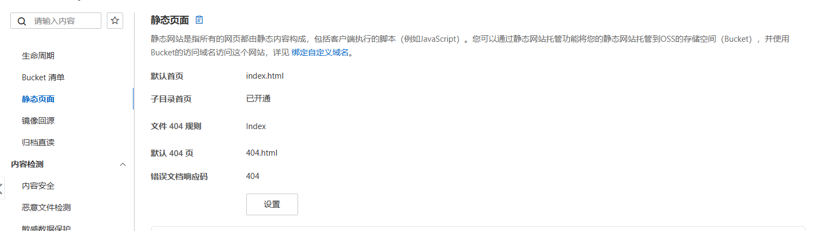
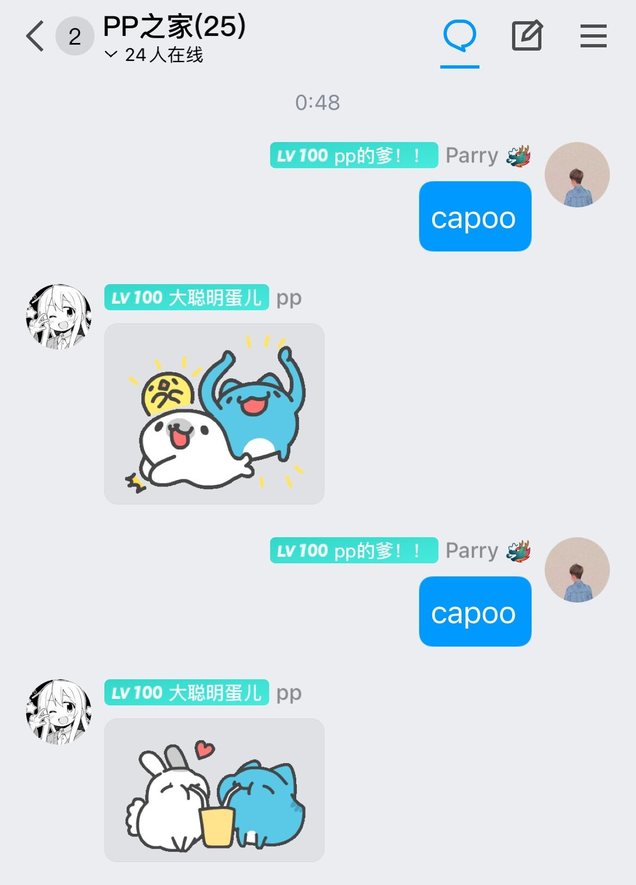
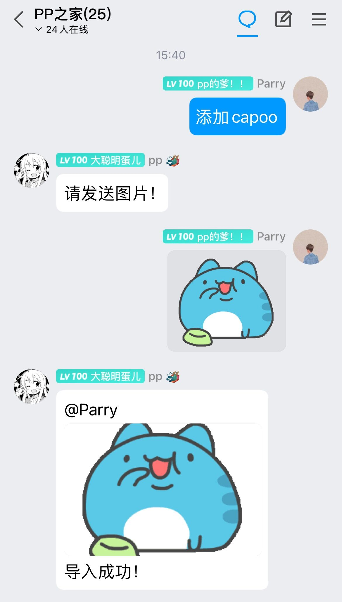
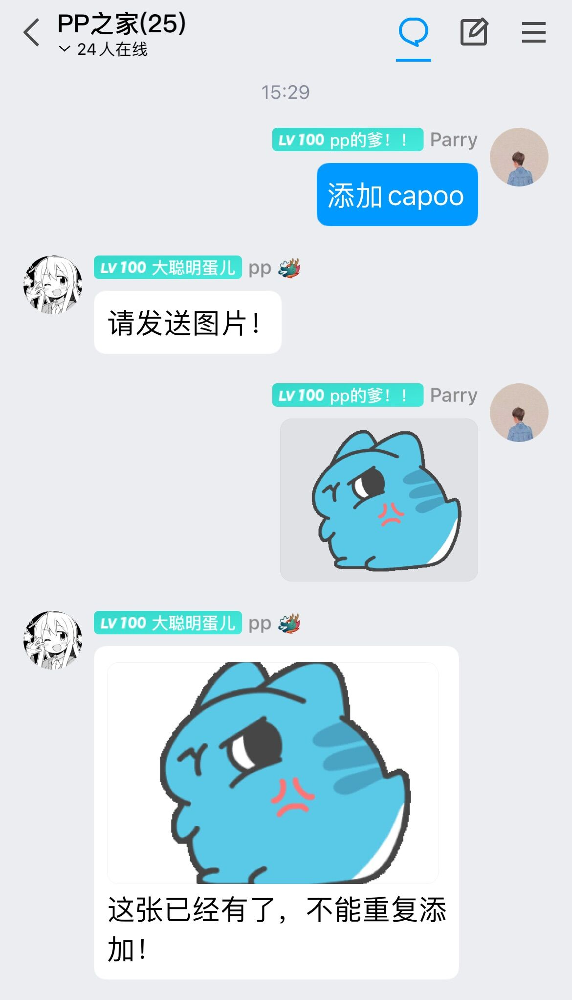
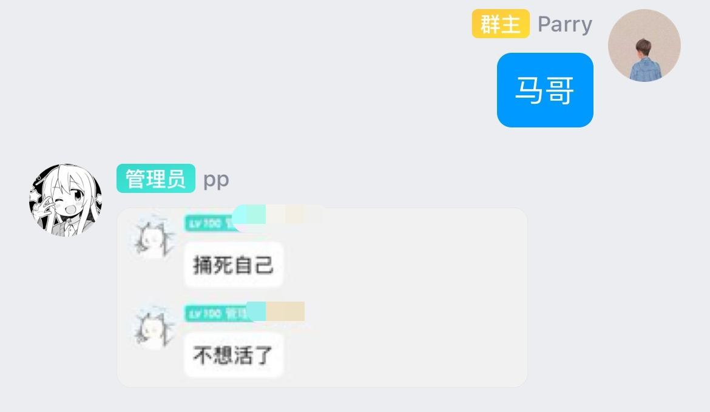
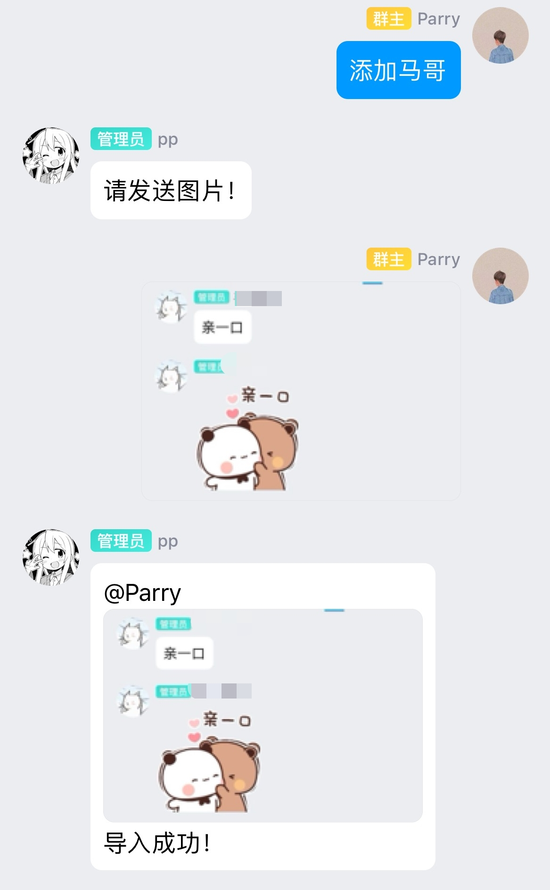
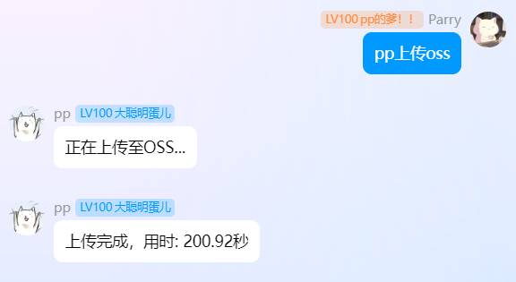
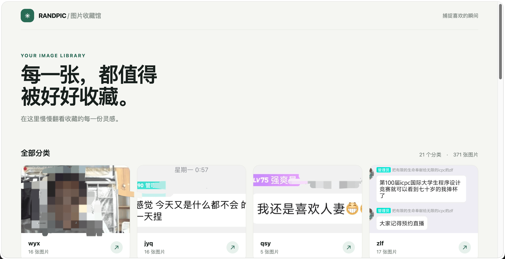

<div align="center">
  <a href="https://v2.nonebot.dev/store"></a>
  <br>
  <p></p>
</div>

<div align="center">

# nonebot-plugin-randpic

_✨ 一个发送指令就能让你的 bot 发出对应指令的图片的插件 ✨_


<a href="./LICENSE">
    
</a>
<a href="https://pypi.python.org/pypi/nonebot-plugin-randpic">
    
</a>


</div>

## 📖 介绍

一个基于 NoneBot2 / OneBot V11 的群聊图库插件，最初衍生自 [nonebot-plugin-capoo](https://github.com/HuParry/nonebot-plugin-capoo)。

- 群员发送图库指令，Bot 随机发送对应分类的图片。
- 群管理员或群主可以添加图片、引用 Bot 发出的图片发送 `删除`，以及按群启用／禁用指令。
- 根据每张图片的发送次数加权抽取：权重为 `1 / (send_count + 1)`，发送次数越少，再次选中的概率越大；每张有效图片都有机会被选中。
- 自动压缩超过 1MiB 的图片，群内添加时使用感知哈希检查相似图片。
- 本地静态图库无需 OSS；可选同步到阿里云 OSS。增删后自动更新网页，网页分页并使用浏览器原生懒加载。

### 初始化与数据持久化

首次启动会创建数据库，并扫描配置的图片文件夹，根据实际图片建立索引，发送次数从 0 开始。数据库不存在时也可由图片文件重新建立索引。

之后每次启动都会核对文件变化，并保留已有图片的发送次数、消息引用关系和同步状态。这些运行数据无法仅凭图片内容恢复，因此不要在正常使用期间删除数据库。

实现说明见 [架构与数据一致性](./docs/architecture.md)。

### 本地存储和离线加图

`randpic_store_dir_path` 指定的路径就是存储根目录，**不会额外追加一层 `randpic`**。未设置时，由 `nonebot-plugin-localstore` 提供默认目录。

例如设置 `randpic_store_dir_path="data/randpic"` 后：

```text
data/randpic/
├── randpic_commands.json   # 指令及各群禁用设置
├── img/
│   ├── capoo/
│   │   └── randpic_capoo_0000000001.png
│   └── 马哥/
├── database/
│   ├── data.db            # 图片、发送次数、历史消息、待同步任务
│   └── ...                # 文件恢复日志、网页上传缓存等内部文件
└── public/                # 自动生成的本地静态网页与图片副本，请勿手动维护
```

Bot 停止时，可以在 `img/<指令>/` 中添加、删除、替换或重命名图片，下次启动会重新核对。新增分类需要先写入 `randpic_commands.json`；仅创建未配置的文件夹不会自动启用新指令。

文件名规则仍为 `randpic_<指令>_<十位编号>.<实际格式后缀>`。规范且主文件名唯一的图片保留原名，其余自动分配新编号。不同后缀共用编号序列，删除后新增也不会复用插件已记录的编号。已有图片仅改名时会尽可能按内容保留其身份和发送次数；同一路径换成不同图片会建立新身份，旧引用不会删除新图。

支持 JPG、PNG、GIF、WebP、BMP、TIFF，以及没有后缀但实际属于这些格式的文件。损坏或无法处理的图片会记录错误并保留原文件，不会强行删除；非图片文件跳过。离线添加不做相似图去重，以免移除用户主动放入的内容。

**超过 1MiB 的图片会压缩，静态图片可能转为 JPG，动画会尽量保留动画和播放时长。需要原图时请自行保留备份。** 群内下载原图默认限制 32MiB，可配置；离线单文件超过 128MiB、超过 400 帧或超大像素的图片请先自行处理。

Bot 运行期间请通过指令增删图片，直接修改文件需重启才能重新索引。一个存储目录只能由一个 Bot 进程维护，同一进程内多个 Bot 账号可以共用。

### 静态网页

#### FastAPI 本地网页

使用 FastAPI 驱动时，Bot 启动后即可通过 `http://<host>:<port>/randpic/` 查看图库，无需配置 OSS。默认每页 100 张图片，可通过 `randpic_web_page_size` 调整。图片使用 `loading="lazy"`，按需加载。

增删图片后本地页面立即重新发布；已打开的网页在可见时每 15 秒检查一次目录版本，发现变化会自动刷新。没有 FastAPI 服务的驱动仍可使用聊天指令和 OSS 同步。

#### 阿里云 OSS

配置全部五项 `randpic_endpoint`、`randpic_bucket`、`randpic_region`、`randpic_oss_access_key_id`、`randpic_oss_access_key_secret` 后启用 OSS 同步。缺少任意一项只关闭 OSS，不影响本地图库。

- `randpic_endpoint`：绑定到 Bucket 的完整网页域名，如 `https://gallery.example.com`。
- `randpic_bucket`：Bucket 名称。
- `randpic_region`：地域 ID，如 `cn-beijing`，可查阅 [OSS 地域和访问域名](https://help.aliyun.com/zh/oss/regions-and-endpoints)。
- AccessKey：需要上传和删除本插件对象的权限。

请配置网页访问权限、域名及静态网站首页 `index.html`，示意如下：



启动、添加和删除后会自动同步；`上传oss` 可手动全量重新发布、重试未完成任务。默认最多 16 个并发请求，终端按节流频率输出独立进度日志，不使用持续占用终端的进度条。

失败任务存入数据库，后台约每 30 秒重试，重启后继续处理。OSS 的图片、页面和目录版本依次同步，网络故障期间云端可能暂时落后于本地图。`randpic_oss_no_upload_list` 只影响 OSS，本地网页仍显示所有配置的分类；此前已同步的分类被排除后，其受本插件跟踪的云端对象会清理。未被数据库跟踪的历史对象不保证自动清理。

## 💿 安装

<details>
<summary>使用 nb-cli 安装</summary>
在 nonebot2 项目的根目录下打开命令行, 输入以下指令即可安装

    nb plugin install nonebot-plugin-randpic

</details>

<details>
<summary>使用包管理器安装</summary>
在 nonebot2 项目的插件目录下, 打开命令行, 根据你使用的包管理器, 输入相应的安装命令

<details>
<summary>pip</summary>

    pip install nonebot-plugin-randpic
</details>
<details>
<summary>pdm</summary>

    pdm add nonebot-plugin-randpic
</details>
<details>
<summary>poetry</summary>

    poetry add nonebot-plugin-randpic
</details>

打开 nonebot2 项目根目录下的 `pyproject.toml` 文件, 在 `[tool.nonebot]` 部分追加写入

    plugins = ["nonebot_plugin_randpic"]

</details>

## ⚙️ 配置

在 nonebot2 项目的`.env`文件中添加下表中的配置，非必填配置不添加也能正常使用。

|            配置项             | 必填 |                 默认值                 |                                 说明                                 |
|:-----------------------------:|:----:|:--------------------------------------:|:--------------------------------------------------------------------:|
|    randpic_store_dir_path     |  否  | get_data_dir("nonebot_plugin_randpic") | 图片存储的路径，用户自定义路径，不定义路径则由localstore插件定义路径 |
|     randpic_banner_group      |  否  |                   []                   |                         不触发发图功能的群聊                         |
|       randpic_endpoint        |  否  |                  None                  |                   填写自定义域名，域名尾部不用加/                    |
|        randpic_bucket         |  否  |                  None                  |                  阿里云OSS对象存储空间名称(bucket)                   |
|        randpic_region         |  否  |                  None                  |                   阿里云OSS对象存储bucket所在地域                    |
|   randpic_oss_access_key_id   |  否  |                  None                  |                        阿里云用户AccessKey ID                        |
| randpic_oss_access_key_secret |  否  |                  None                  |                      阿里云用户AccessKey Secret                      |
|  randpic_oss_no_upload_list   |  否  |                   []                   | 不发布到 OSS 的分类，本地网页仍然可见 |
| randpic_upload_concurrency | 否 | 16 | OSS 并发数，范围 1–64 |
| randpic_download_max_mb | 否 | 32 | 群内图片下载大小上限（MiB），范围 1–256 |
| randpic_download_timeout | 否 | 30 | 下载网络超时秒数，范围大于 0、不超过 300 |
| randpic_web_page_size | 否 | 100 | 网页每页图片数，范围 1–500 |

在插件的本地存储目录下会有 `randpic_commands.json` 文件，该文件存储了对应指令以及每个指令的分群禁用配置。群里添加新指令、`@bot 禁用<指令>`、`@bot 启用<指令>` 都会修改这个文件，你也可以自己改完后重启 bot。

文件结构是「指令名 → 在该群号集合中被禁用」，例如：

```json
{
  "capoo": [],
  "马哥": [123456789]
}
```

上面表示 `capoo` 指令对所有群启用，`马哥` 指令仅在群号 `123456789` 中被禁用。

在 `.env` 中，例如这样配置（这是例子，不代表你也需要这样配置）：
```
randpic_store_dir_path="data/randpic"
randpic_banner_group=[574145050]
randpic_endpoint="https://xxx.huparry.cn"
randpic_bucket="randpic"
randpic_region="cn-beijing"
randpic_oss_access_key_id="xxxxxxxxxxxxxxxxxxxxxx"
randpic_oss_access_key_secret="xxxxxxxxxxxxxxxxxxxxx"
randpic_oss_no_upload_list=["capoo"]
```


## 🎉 使用

### 指令表
|     指令     | 权限 | 需要@ | 范围 |              说明               |
|:----------:|:--:|:---:|:--:|:-----------------------------:|
| `<你设置的指令>` | 群员 |  否  | 群聊 |         随机发送一张对应指令的图片         |
|  `添加<指令>`  | 群管 |  否  | 群聊 |       让 bot 存储图片到对应文件夹下       |
| 引用图片后发送 `删除` | 群管／群主 | 否 | 群聊 | 从图库删除被引用图片，并同步网页及 OSS |
|  `禁用<指令>`  | 群管 |  是  | 群聊 |   在本群禁用该指令，之后该指令在本群将不再触发发图    |
|  `启用<指令>`  | 群管 |  是  | 群聊 |        恢复本群被禁用的指令         |
|  `上传oss`   | 群管／群主 | 否 | 群聊 | 刷新本地网页；配置 OSS 时全量重新同步并重试待处理任务 |

### 引用删除图片

群管理员或群主引用本插件发送的图库图片，再发送 `删除` 即可。添加成功时 Bot 回复的图片也支持引用删除。

- 删除会移除原图和网页副本，并将数据库中的图片标记为已删除，并在启用 OSS 时删除云端对象、更新页面；影响所有群共用的图库，不会撤回已经发送的 QQ 消息。
- 消息与图片的对应关系会持久化，重启 Bot 后仍可引用删除。升级前发送、尚未建立对应记录的历史消息无法直接删除，请让 Bot 重新发送对应图片后再操作。
- 删除过的图片再次引用会提示已删除；若网页或 OSS 同步失败，再次引用原消息发送 `删除` 可重试，`上传oss` 也会重试未完成的删除同步。

### 效果图
#### `capoo` 指令


#### `添加capoo` 指令




#### `马哥` 指令


#### `添加马哥` 指令



#### `上传oss` 指令


#### `禁用马哥` 指令


#### `启用马哥` 指令


#### 静态页面网页示意（支持本地及 OSS）


## 本地开发检查

安装项目依赖后，在仓库根目录运行：

```shell
python -m unittest discover -s tests -t . -v
```

检查使用临时目录和模拟的 QQ／OSS 请求，不连接真实群聊或云端。实际部署后仍需结合自己的 OneBot 实现和 OSS 配置确认联通性。

## TODO
- [x] 指令触发 bot 发送图片
- [x] 在 QQ 上让 bot 存储对应指令的图片
- [x] 每次存储图片，判断相似图片是否已经存在，避免重复加入
- [X] 由capoo插件衍生成一个模板插件，即仅需修改参数就能发送别的图片
- [X] 添加图片压缩功能，避免图片文件夹空间过大
- [X] 以阿里云OSS对象存储搭建静态网页，便于浏览器查看图片
- [X] Bot使用期间也能在群内直接添加新指令。
- [X] 完善权限管理机制，采用更详细的权限管理，避免插件滥用
- [ ] 添加智能识图选项（调用api），避免添加违禁图导致被风控

## 鸣谢
感谢以下开发者作出的贡献：

<a href="https://github.com/HuParry/nonebot-plugin-randpic/graphs/contributors">
  
</a>
